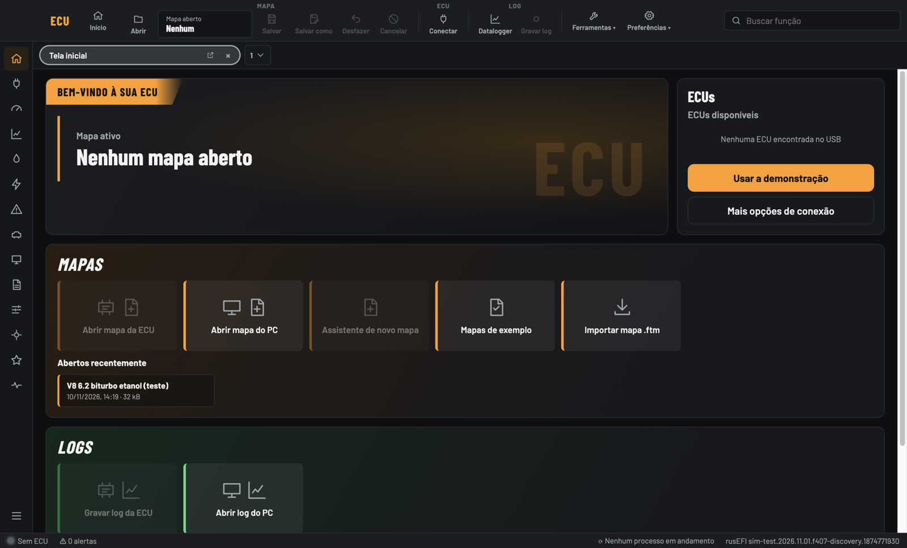

# ECU master — projeto da injeção programável (base rusEFI)

Tudo do projeto da ECU num lugar só: firmware, placa, notas e o programa de ajuste.

| Pasta | O que tem |
|---|---|
| [`01-Firmware-rusEFI`](01-Firmware-rusEFI) | Configuração da placa no rusEFI e os patches de todas as melhorias |
| [`02-Placas-PCB`](02-Placas-PCB) | Placa top 6c completa (KiCad): esquema, placa e caixa 3D |
| [`03-Manuais-e-notas`](03-Manuais-e-notas) | Notas da placa, resumo das funções e como continuar o projeto |
| [`04-App-interface`](04-App-interface) | Programa de ajuste no computador: link para o código, exemplos e fotos |

## Programa de ajuste



- Código: **[CarlosCiconato/ecu-app](https://github.com/CarlosCiconato/ecu-app)**
- Baixar (Mac e Windows): **[Releases](https://github.com/CarlosCiconato/ecu-app/releases)**

## Firmware

- Base: rusEFI oficial, commit `1b0196058f6`, com as nossas melhorias em patches.
- Código do rusEFI: baixe em **https://github.com/rusefi/rusefi** e volte para o commit base:
  ```bash
  git clone https://github.com/rusefi/rusefi.git
  cd rusefi
  git checkout 1b0196058f6
  # depois aplique os patches de 01-Firmware-rusEFI/patches com git am, na ordem dos itens
  ```
  A ordem dos itens e os detalhes estão em `03-Manuais-e-notas/CONTINUAR.md`.
- Resumo da placa: [`placa-top6c-firmware.md`](01-Firmware-rusEFI/placa-top6c-firmware.md).

## Continuar o projeto

Veja [`03-Manuais-e-notas/CONTINUAR.md`](03-Manuais-e-notas/CONTINUAR.md) e [`LEIA-ME.md`](LEIA-ME.md).

